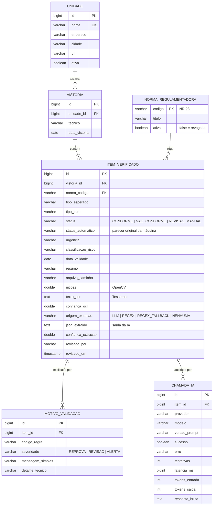
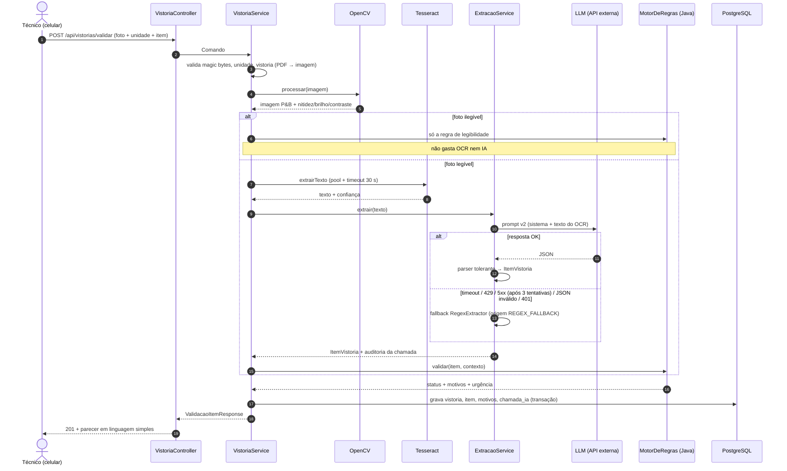

# 3. Banco de Dados e API

> Entrega Parcial GrowUp · Item 3 (2,0 pts) · Schema real em `backend/src/main/resources/db/migration/`

## 3.1 Modelo de dados



| Entidade | Papel | Chaves |
|---|---|---|
| `unidade` | Restaurante (filial) da rede | PK `id`; `nome` único |
| `norma_regulamentadora` | NRs usadas no checklist; `ativa=false` marca norma revogada | PK `codigo` (natural) |
| `vistoria` | Uma visita do técnico a uma unidade (o checklist) | PK `id`; FK `unidade_id` |
| `item_verificado` | Uma evidência (foto/PDF) e o parecer sobre ela | PK `id`; FK `vistoria_id`, FK `norma_codigo` |
| `motivo_validacao` | Cada apontamento das regras (explica o parecer) | PK `id`; FK `item_id` (cascade) |
| `chamada_ia` | **Entidade de IA**: auditoria de cada chamada ao LLM (custo, latência, falha, versão do prompt) | PK `id`; FK `item_id` (cascade) |

**Decisões:**
- `status_automatico` nunca muda; `status` é o final (pode ser alterado pelo supervisor). Assim medimos a concordância IA × humano.
- O JSON da IA fica guardado (`json_extraido`) junto com o texto do OCR: dá para reprocessar e auditar.
- A imagem fica em disco/volume (`arquivo_caminho`), não no banco.
- Índices em `vistoria.unidade_id`, `item_verificado.vistoria_id` e `item_verificado.status` (fila de revisão).

## 3.2 Endpoints

Base: `http://localhost:8080/api` · Erros no formato RFC 7807 (`application/problem+json`) com o campo extra `mensagem`.

| Método | Rota | Descrição | Sucesso |
|---|---|---|---|
| `POST` | `/vistorias/validar` | **Principal.** Recebe a foto/PDF (multipart) e devolve o parecer | 201 |
| `POST` | `/vistorias` | Abre uma vistoria (checklist) vazia | 201 |
| `GET` | `/vistorias?unidadeId=` | Últimas 50 vistorias (com itens resumidos) | 200 |
| `GET` | `/vistorias/{id}` | Detalhe de uma vistoria | 200 |
| `GET` | `/itens/{id}` | Detalhe completo de um item (pipeline, motivos, revisão) | 200 |
| `GET` | `/itens?status=REVISAO_MANUAL` | Fila do supervisor (ou filtro por qualquer status) | 200 |
| `PATCH` | `/itens/{id}/revisao` | Decisão do supervisor | 200 |
| `GET` | `/itens/{id}/arquivo` | Evidência original | 200 |
| `GET` | `/unidades` · `/normas` · `/tipos-item` | Cadastros de apoio | 200 |
| `GET` | `/painel` | Indicadores de compliance | 200 |
| `GET` | `/actuator/health` | Saúde da aplicação (fora de `/api`) | 200 |

### `POST /api/vistorias/validar`

Requisição (`multipart/form-data`):

| Campo | Tipo | Obrigatório | Exemplo |
|---|---|---|---|
| `arquivo` | arquivo JPG/PNG/PDF ≤ 10 MB | sim | foto do selo |
| `unidadeId` | número | sim | `1` |
| `tecnico` | texto | sim | `Elisa Martins` |
| `tipoItem` | `EXTINTOR`, `SAIDA_EMERGENCIA`, `PISO_ANTIDERRAPANTE`, ... | não (recomendado) | `EXTINTOR` |
| `localizacao` | texto | não | `COZINHA` |
| `vistoriaId` | número | não — sem ele, cria uma vistoria nova | `3` |

```bash
curl -F arquivo=@exemplos/2-extintor-vencido.jpg -F unidadeId=1 -F tecnico="Elisa Martins" \
     -F tipoItem=EXTINTOR -F localizacao=COZINHA http://localhost:8080/api/vistorias/validar
```

Resposta `201 Created` (resumida):

```json
{
  "itemId": 7,
  "vistoriaId": 3,
  "unidade": "Sabor & Cia - Boa Viagem",
  "status": "NAO_CONFORME",
  "statusAutomatico": "NAO_CONFORME",
  "urgencia": "CRITICA",
  "resumo": "O extintor está vencido desde 10/08/2026 (há 101 dias). Providencie a recarga com o fornecedor.",
  "motivos": [
    {
      "regra": "VALIDADE",
      "severidade": "REPROVA",
      "mensagem": "O extintor está vencido desde 10/08/2026 (há 101 dias). Providencie a recarga com o fornecedor.",
      "detalheTecnico": "Vencido em 2026-08-10 (101 dias antes de 2026-11-19)"
    }
  ],
  "tipoEsperado": "EXTINTOR",
  "tipoItem": "EXTINTOR",
  "localizacao": "COZINHA",
  "dataValidade": "2026-08-10",
  "classificacaoRisco": "INCENDIO",
  "norma": "NR-23",
  "pipeline": {
    "nitidez": 283.8, "brilho": 122.4, "contraste": 76.3,
    "textoOcr": "EXTINTOR PQS 4 kg - Classe BC\nUnidade: Sabor & Cia - Boa Viagem\n...\nValidade: 10/08/2026\nNorma: NR-23 | Selo INMETRO 004512",
    "confiancaOcr": 92.8,
    "origemExtracao": "LLM",
    "dadosExtraidos": {
      "tipoItem": "EXTINTOR", "unidade": "Sabor & Cia - Boa Viagem", "itemPresente": true,
      "condicaoVisual": null, "seloValidadePresente": true, "dataValidade": "10/08/2026",
      "localizacao": "COZINHA", "classificacaoRisco": "INCENDIO", "normaAssociada": "NR-23", "confianca": 0.93
    },
    "confiancaExtracao": 0.93,
    "regrasAplicadas": ["LEGIBILIDADE", "CAMPOS_OBRIGATORIOS", "ITEM_CORRESPONDE", "ITEM_PRESENTE",
                        "SELO_VALIDADE", "VALIDADE", "RISCO_COMPATIVEL", "NORMA_VIGENTE", "UNIDADE_CONFERE", "CONFIANCA_IA"],
    "tempoProcessamentoMs": 2310
  },
  "revisao": null,
  "criadoEm": "2026-11-19T23:30:00"
}
```

### `PATCH /api/itens/{id}/revisao`

```json
{ "status": "CONFORME", "supervisor": "Paulo Lima", "observacao": "Selo legível na foto original, validade 08/2027." }
```

Respostas: `200` com o item atualizado · `400` dados inválidos · `404` item não existe · `422` status `REVISAO_MANUAL` ou item já revisado.

### Exemplo de erro

```json
{
  "type": "about:blank",
  "title": "Bad Request",
  "status": 400,
  "detail": "Formato não suportado. Envie uma foto JPG/PNG ou um PDF.",
  "codigo": "ARQUIVO_INVALIDO",
  "mensagem": "Formato não suportado. Envie uma foto JPG/PNG ou um PDF."
}
```

## 3.3 Fluxo completo de uma requisição



## 3.4 Tratamento de exceções e casos de falha

### Erros de entrada e de negócio (chegam ao cliente)

| Situação | Exceção | HTTP | `codigo` |
|---|---|---|---|
| Arquivo vazio, formato não suportado, PDF corrompido | `ArquivoInvalidoException` | 400 | `ARQUIVO_INVALIDO` |
| Arquivo > 10 MB | `MaxUploadSizeExceededException` | 413 | `ARQUIVO_MUITO_GRANDE` |
| Campo obrigatório ausente (`unidadeId`, `tecnico`, `arquivo`) | `MissingServletRequest*` | 400 | `CAMPO_OBRIGATORIO` |
| `tipoItem` ou `status` com valor inexistente | `MethodArgumentTypeMismatchException` | 400 | `VALOR_INVALIDO` |
| Bean Validation no JSON (supervisor em branco...) | `MethodArgumentNotValidException` | 400 | `DADOS_INVALIDOS` |
| Unidade / vistoria / item não encontrados | `RecursoNaoEncontradoException` | 404 | `NAO_ENCONTRADO` |
| Vistoria de outra unidade; revisar duas vezes | `RegraDeNegocioException` | 422 | `OPERACAO_INVALIDA` |
| Qualquer outro erro | `Exception` (logado com stack trace) | 500 | `ERRO_INTERNO` (mensagem genérica, sem detalhes internos) |

### Falhas de integração (não chegam ao cliente como erro)

| Falha | Onde | Tratamento | Resultado para o usuário |
|---|---|---|---|
| **Timeout** do LLM | `OpenAiCompatibleClient` | connect 5 s / leitura 20 s; nova tentativa | — |
| **Conexão recusada / DNS** | idem | `ResourceAccessException` → nova tentativa | — |
| **HTTP 429** (limite de uso) e **5xx** | idem | até 3 tentativas com espera 1 s, 2 s | — |
| Falhou nas 3 tentativas | `IaIndisponivelException` | fallback por Regex; `chamada_ia.sucesso=false` | REVISAO_MANUAL: "a análise automática ficou incompleta" |
| **HTTP 400/401/403/404** (chave errada, modelo inexistente) | `IaConfiguracaoException` | sem nova tentativa (não adianta); fallback | REVISAO_MANUAL |
| **Resposta inesperada**: vazia, texto livre, JSON cortado (`finish_reason=length`), sem campos | `RespostaIaInvalidaException` | fallback | REVISAO_MANUAL |
| **Resposta inconsistente**: data impossível, risco incompatível, outra unidade | regras Java | apontamento REVISAO | REVISAO_MANUAL com o motivo |
| **Resposta incompleta**: campo obrigatório `null` | regras Java | REPROVA ou REVISAO, conforme o campo | mensagem dizendo o que faltou |
| **Baixa confiança** (< 0,7) | `RegraConfiancaIa` | REVISAO | REVISAO_MANUAL |
| **Latência** alta | config | timeouts curtos; OCR e IA não rodam para foto ilegível; texto do OCR limitado a 4.000 caracteres | parecer em poucos segundos |
| Tesseract ausente/travado | `TesseractOcrService` | pool de 2 threads + timeout 30 s → `OcrIndisponivelException` | REVISAO_MANUAL "OCR_INDISPONIVEL" |
