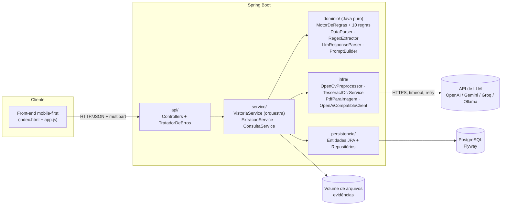

# 4. Arquitetura de Software e Stack de Desenvolvimento

> Entrega Parcial GrowUp · Item 4 (2,0 pts)

## 4.1 Stack

| Camada | Tecnologia | Por quê | Custo |
|---|---|---|---|
| Linguagem / backend | **Java 17 + Spring Boot 3.3** (Web, Data JPA, Validation, Actuator) | Stack da trilha; tipagem forte para regras de negócio; `record` para o JSON da IA | Gratuito |
| Visão computacional | **OpenCV 4.9** (`org.openpnp:opencv`, já traz as bibliotecas nativas) | Trata a foto: perspectiva, rotação, contraste, ruído, binarização e métricas de nitidez | Gratuito |
| OCR | **Tesseract 5** via **Tess4J**, idioma `por` | OCR local, sem enviar a foto para terceiros | Gratuito |
| PDF | **Apache PDFBox 3** | Converte checklist em PDF para imagem | Gratuito |
| IA (LLM) | Qualquer API **compatível com OpenAI** `/chat/completions` | Troca de provedor só por variável de ambiente | ver abaixo |
| Banco | **PostgreSQL 16** + **Flyway** (H2 no perfil `dev`) | Relacional, migrações versionadas no Git | Gratuito |
| Front-end | HTML + CSS + JavaScript puro, mobile-first, servido pelo próprio Spring | Zero build, abre no celular | Gratuito |
| Testes | JUnit 5 | 36 testes de domínio (rodam sem banco e sem IA) | Gratuito |
| Infra | Docker + Docker Compose; GitHub Actions (CI) | Sobe tudo com um comando; testes a cada push | Gratuito (CI público) |
| Desenvolvimento | Assistente de IA (Claude) para código, testes e revisão | Acelera; tudo validado por compilação/testes | Plano do aluno |

### Ferramentas de IA: pagas × gratuitas

| Provedor (configurável) | Tipo | Observações |
|---|---|---|
| **OpenAI** `gpt-4o-mini` (padrão) | Pago por token | Muito barato para este uso. Estimativa: ~900 tokens de entrada + ~200 de saída por item → fração de centavo por item. Confira a tabela de preços atual. Suporta JSON mode e imagem |
| **Google Gemini** (endpoint compatível com OpenAI) | Camada gratuita com limites | Bom para a demo; aceita imagem (multimodal) |
| **Groq** (modelos Llama abertos) | Camada gratuita com limites | Muito rápido; só texto |
| **Ollama** (local) | Gratuito | Roda na máquina; sem internet; mais lento sem GPU |
| **Modo `regex`** | Gratuito, sem IA | Palavras-chave + Regex; ótimo para layout conhecido e para ensinar a diferença |
| Claude / AWS Bedrock | Pago | Possíveis via adaptador (nova implementação de `LlmClient`) |

## 4.2 Arquitetura



**Princípios:**
1. **Domínio sem framework.** Regras, parser da IA e Regex são Java puro → testáveis em milissegundos, sem banco e sem IA.
2. **IA atrás de uma interface** (`LlmClient`). Trocar de provedor não muda o resto do código.
3. **Cada tecnologia tem um papel claro:** preparar (OpenCV) → ler (Tesseract) → interpretar (IA) → validar (Java) → persistir (PostgreSQL).
4. **A IA extrai; o Java decide.**
5. **Processamento fora da transação**; só a gravação final é transacional (não segura conexão do banco enquanto espera a IA).

## 4.3 Estrutura de pastas

```
vistoria-inteligente-ia/
├── docker-compose.yml          # PostgreSQL + aplicação
├── .env.example                # provedor de IA, chave, modelo
├── .github/workflows/ci.yml    # testes a cada push
├── docs/                       # esta entrega
├── exemplos/                   # 3 imagens da demo + script que as gera
└── backend/
    ├── Dockerfile              # build Maven + runtime com Tesseract 5 (Ubuntu 24.04)
    ├── pom.xml
    └── src/
        ├── main/java/br/com/saborecia/vistoria/
        │   ├── api/                 # REST: VistoriaController, CadastroController, TratadorDeErros, dto/
        │   ├── config/              # VistoriaProperties (application.yml), BeansConfig
        │   ├── dominio/             # ★ Java puro
        │   │   ├── ItemVistoria.java        # record = JSON devolvido pela IA
        │   │   ├── TipoItem, ClassificacaoRisco, StatusItem, Urgencia, DataParser...
        │   │   ├── extracao/                # PromptBuilder, LlmResponseParser, RegexExtractor
        │   │   └── regras/                  # MotorDeRegras + uma classe por regra
        │   ├── excecao/             # exceções de negócio e de integração
        │   ├── infra/
        │   │   ├── imagem/          # OpenCvPreprocessor
        │   │   ├── ocr/             # TesseractOcrService
        │   │   ├── pdf/             # PdfParaImagem
        │   │   └── ia/              # LlmClient + OpenAiCompatibleClient
        │   ├── persistencia/        # entidade/ + repositorio/
        │   └── servico/             # VistoriaService, ExtracaoService, ConsultaService, ArmazenamentoService
        ├── main/resources/
        │   ├── application.yml
        │   ├── db/migration/        # V1__schema.sql, V2__dados_iniciais.sql
        │   ├── prompts/             # extracao-item-v2.txt (prompt versionado)
        │   └── static/              # front-end
        └── test/java/...            # JUnit
```

## 4.4 Integração do backend com a IA

1. `VistoriaService` chama `ExtracaoService.extrair(textoOcr, foto, tipoEsperado, local, unidade, hoje)`.
2. `PromptBuilder` monta **sistema** (papel, regras, formato JSON, valores válidos) + **usuário** (contexto do técnico + texto do OCR entre `"""`, truncado em 4.000 caracteres).
3. `OpenAiCompatibleClient` envia `model`, `temperature: 0`, `response_format: {type: json_object}` e as mensagens (com a imagem em base64 se `LLM_ENVIAR_IMAGEM=true`).
4. `LlmResponseParser` converte a resposta em `ItemVistoria` (record Java).
5. A chamada é registrada em `chamada_ia` (provedor, modelo, versão do prompt, tokens, latência, tentativas, erro, resposta bruta).

## 4.5 Latência, erros, timeout e indisponibilidade

| Problema | Estratégia |
|---|---|
| **Latência** | Foto ilegível não passa por OCR/IA; imagem padronizada em 1200 px; OCR em uma passada; texto limitado; modelo pequeno e temperatura 0; front mostra o progresso por etapa |
| **Timeout** | Conexão 5 s, leitura 20 s (`LLM_TIMEOUT`); OCR 30 s em pool próprio |
| **Erro temporário** (429, 5xx, rede) | Até 3 tentativas com *backoff* exponencial (1 s, 2 s) |
| **Erro permanente** (400/401/403/404) | Sem nova tentativa; log de configuração; fallback |
| **Indisponibilidade** | *Fallback* por Regex → item em REVISAO_MANUAL; a API continua respondendo 201 |
| **Resposta ruim** | Parser tolerante + regras de coerência + limite de confiança |
| **Sobrecarga** | Pool de OCR limitado (`max-paralelo: 2`); limite de upload 10 MB |
| **Monitoramento** | `/actuator/health` e `/actuator/metrics`; logs com status/origem/tempo por item; tabela `chamada_ia` |

**Próximos passos de robustez (pós-MVP):** *circuit breaker* (Resilience4j) para parar de chamar a IA durante uma queda; processamento assíncrono com fila quando o volume crescer; cache por hash da imagem para não pagar duas vezes pela mesma foto.
